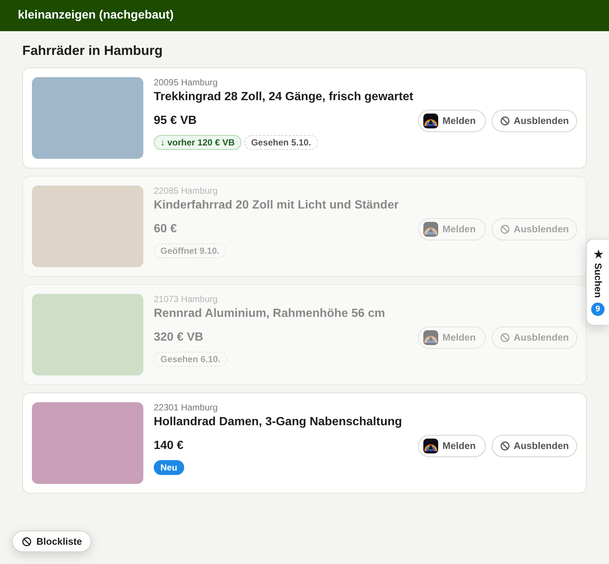
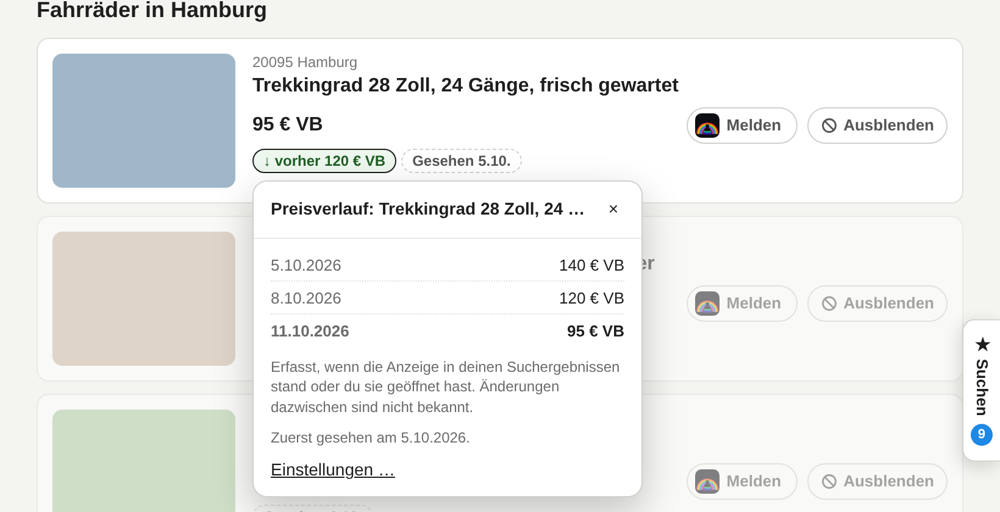
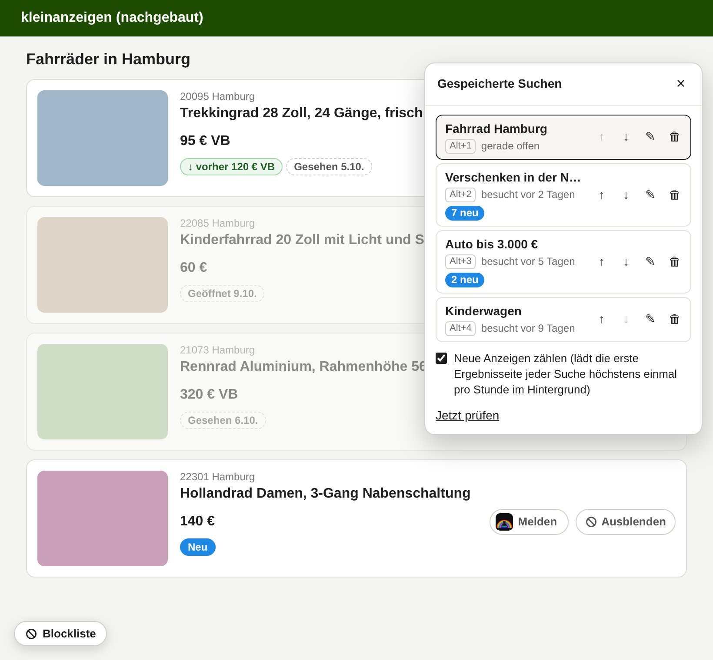
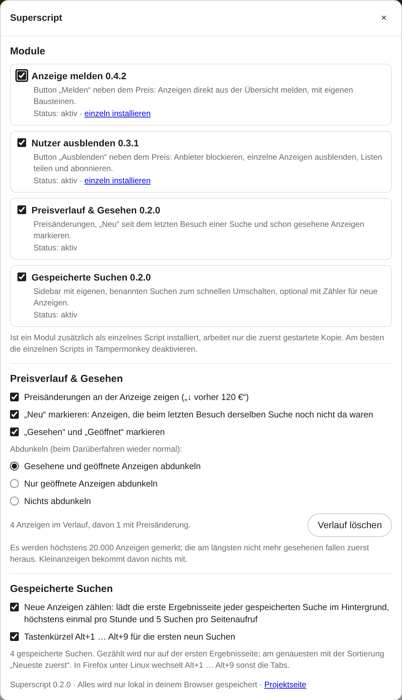

<div align="center">


# 🧰 Kleinanzeigen – Superscript

**Alles in einem Userscript für Kleinanzeigen.de: Preisverlauf, neue und schon gesehene Anzeigen, gespeicherte Suchen, Melden aus der Übersicht und eine eigene Blockliste.**

[](https://github.com/RainbowLabsInc/Kleinanzeigen.de_Superscript/raw/main/superscript.user.js)
[](https://www.kleinanzeigen.de)
[](#%EF%B8%8F-installation)
[](LICENSE)
[](https://ko-fi.com/rainbowlabsinc)

*Chrome · Firefox · Edge · Kein eigener Server · Kein Tracking · Jedes Modul einzeln abschaltbar*

<a href="https://github.com/RainbowLabsInc/Kleinanzeigen.de_Superscript/raw/main/superscript.user.js"></a>

</div>

---

Wer auf Kleinanzeigen etwas Bestimmtes sucht, schaut oft tagelang dieselbe Suche durch. Welche Anzeigen sind neu? Welche kenne ich schon? Ist das Rad von gestern billiger geworden? Kleinanzeigen beantwortet das nicht.

**Das Superscript merkt es sich für dich**, lokal in deinem Browser. Mit der Sidebar „Gespeicherte Suchen“ schaltest du mit einem Klick zwischen deinen Suchen hin und her. Dazu enthält es die beiden Userscripts [Anzeige melden](https://github.com/RainbowLabsInc/Kleinanzeigen.de_Anzeige_melden) und [Nutzer ausblenden](https://github.com/RainbowLabsInc/Kleinanzeigen.de-User_ausblenden). Du installierst also nur noch ein Script statt drei.

| Modul | Was es macht | Einzeln erhältlich |
|---|---|---|
| 🏷️ **Preisverlauf & Gesehen** | Preisänderungen mit Datum, „Neu“ seit deinem letzten Besuch einer Suche, „Gesehen“ und „Geöffnet“, auf Wunsch abgedunkelt | nein, nur im Superscript |
| ★ **Gespeicherte Suchen** | Sidebar mit eigenen, benannten Suchen, Umschalten per Klick oder Alt+1 … Alt+9, optional Zähler für neue Anzeigen | nein, nur im Superscript |
| 🚩 **Anzeige melden** (0.4.2) | Button „Melden“ neben dem Preis: Anzeigen direkt aus der Übersicht melden, mit eigenen Bausteinen | [ja](https://github.com/RainbowLabsInc/Kleinanzeigen.de_Anzeige_melden) |
| 🚫 **Nutzer ausblenden** (0.3.1) | Button „Ausblenden“ neben dem Preis: Anbieter blockieren, einzelne Anzeigen ausblenden, Listen teilen und abonnieren | [ja](https://github.com/RainbowLabsInc/Kleinanzeigen.de-User_ausblenden) |

Die beiden übernommenen Module sind **unverändert** die jeweils aktuelle Version der Einzel-Scripts. Deren Beschreibung und Bedienung findest du in den verlinkten Projekten.

<p align="center">
  
  <br><sub>Zweiter Besuch derselben Suche (Darstellung an einer nachgebauten Seite): oben eine Preissenkung, in der Mitte zwei bekannte Anzeigen, abgedunkelt, unten eine neue.</sub>
</p>

---

## ✨ Preisverlauf & Gesehen

* 🏷️ **Preisänderungen:** Hat sich der Preis einer Anzeige geändert, seit sie zuletzt in deinen Suchergebnissen stand, steht unter dem Preis z. B. **„↓ vorher 120 € VB“** (grün) oder **„↑ vorher 95 €“** (orange). Ein Klick zeigt den ganzen Verlauf mit Datum.
* 🆕 **Neu:** Anzeigen, die bei deinem letzten Besuch **derselben Suche** noch nicht zu sehen waren, bekommen ein blaues **„Neu“**. Beim allerersten Besuch einer Suche erscheint es nicht, sonst wäre alles neu.
* 👀 **Gesehen und Geöffnet:** Anzeigen, die du schon kennst, tragen **„Gesehen 4.10.“** bzw. **„Geöffnet 8.10.“**.
* 🌗 **Abdunkeln:** Bekannte Anzeigen werden blass dargestellt, beim Darüberfahren wieder normal. So springen die neuen ins Auge. Wahlweise nur geöffnete oder gar nichts abdunkeln. Hat sich der Preis gerade geändert, bleibt die Anzeige hell.
* 📄 **Auf der Anzeigenseite:** Unter dem Preis steht der bisherige Preisverlauf und wann du die Anzeige zuerst gesehen und zuletzt geöffnet hast.
* 🔒 **Ohne Anfragen:** Das Modul liest nur, was ohnehin auf der Seite steht. Es lädt nichts nach und schickt nichts weg.

<p align="center">
  
  <br><sub>Klick auf „↓ vorher 120 € VB“: der Verlauf mit Datum (Beispieldaten).</sub>
</p>

Kleinanzeigen zeigt manchmal selbst einen durchgestrichenen Altpreis. Das Modul ergänzt ihn um das Datum und behält auch mehrere Änderungen hintereinander.

---

## ★ Gespeicherte Suchen

* 📌 **Suchen speichern:** Am rechten Rand sitzt der Reiter **„★ Suchen“**. Aufgeklappt speicherst du die gerade offene Suche mit einem Namen, z. B. „Verschenken in der Nähe“ oder „Auto bis 3.000 €“. Der Name wird aus dem Suchbegriff vorgeschlagen.
* 🔀 **Umschalten:** Ein Klick auf eine Suche öffnet sie, die Sidebar bleibt dabei offen. Mittelklick öffnet die Suche in einem neuen Tab. Die ersten neun Suchen erreichst du auch mit **Alt+1 … Alt+9**.
* ✏️ **Ordnen:** Umbenennen (✎), verschieben (↑ ↓) und löschen (🗑) direkt in der Liste. Die gerade offene Suche ist umrandet, auch auf Seite 2, 3 … Zu jeder Suche steht, wann du sie zuletzt besucht hast.
* 🔵 **„7 neu“ (optional, standardmäßig aus):** Wenn eingeschaltet, lädt das Script die erste Ergebnisseite jeder gespeicherten Suche im Hintergrund, höchstens einmal pro Stunde und höchstens 5 Suchen pro Seitenaufruf, und zählt Anzeigen, die bei deinem letzten Besuch der Suche noch nicht da waren. Schon gesehene, einzeln ausgeblendete und Anzeigen blockierter Anbieter zählen nicht mit. Die Summe steht auch am eingeklappten Reiter.

Gespeichert wird die Adresse der Ergebnisseite ohne Seitenzahl, also mit allen Filtern, die Kleinanzeigen in der Adresse führt (Ort, Umkreis, Preis, Sortierung usw.). Gezählt wird nur die erste Ergebnisseite; am genauesten ist das mit der Sortierung „Neueste zuerst“.

<p align="center">
  
  <br><sub>Die Sidebar aufgeklappt (nachgebaute Seite, Beispieldaten).</sub>
</p>

> Kleinanzeigen hat eigene Suchaufträge mit E-Mail-Benachrichtigung, die ein Konto voraussetzen. Die Sidebar ist davon unabhängig, braucht kein Login und ist vor allem zum schnellen Hin- und Herschalten gedacht.

---

## ⚙️ Installation

**Schritt 1: Userscript-Erweiterung installieren** (kostenlos)

| Browser | Erweiterung |
|---|---|
| Chrome / Edge | [Tampermonkey](https://chrome.google.com/webstore/detail/tampermonkey/dhdgffkkebhmkfjojejmpbldmpobfkfo) oder [Violentmonkey](https://chrome.google.com/webstore/detail/violentmonkey/jinjaccalgkegednnccohejagnlnfdag) |
| Firefox | [Tampermonkey](https://addons.mozilla.org/de/firefox/addon/tampermonkey/) oder [Violentmonkey](https://addons.mozilla.org/de/firefox/addon/violentmonkey/) |

> **Chrome/Edge:** Bei neueren Tampermonkey-Versionen muss in den Erweiterungs-Details „Benutzerskripte zulassen“ bzw. der Entwicklermodus aktiviert sein.

**Schritt 2: Superscript installieren**

<a href="https://github.com/RainbowLabsInc/Kleinanzeigen.de_Superscript/raw/main/superscript.user.js"></a>

*(Alternativ: Inhalt von `superscript.user.js` kopieren und in Tampermonkey als neues Skript einfügen.)*

Updates holt sich Tampermonkey automatisch aus diesem Repo. Das Superscript braucht dieselben Berechtigungen wie „Nutzer ausblenden“, darunter `GM_xmlhttpRequest` für abonnierte Blocklisten.

### Umstieg von den einzelnen Scripts

1. **Blockliste sichern:** Im bisherigen Script „Nutzer ausblenden“ unten links auf **„Blockliste“** → **Export** → **„Als JSON speichern“**. Das ist nötig, weil Tampermonkey jedem Script einen eigenen Speicher gibt.
2. In Tampermonkey **„Anzeige melden“** und **„Nutzer ausblenden“ deaktivieren** (oder löschen).
3. **Superscript installieren** (siehe oben) und Kleinanzeigen neu laden.
4. **Blockliste zurückspielen:** **„Blockliste“** → **„Datei wählen …“** → die gespeicherte Datei → in der Vorschau **„Meine Liste ersetzen“**. Abonnierte Listen bitte neu eintragen; sie werden nicht exportiert.

Bausteine und „Gemeldet“-Markierungen von „Anzeige melden“ liegen im Browser-Speicher von kleinanzeigen.de und sind im Superscript **automatisch wieder da**.

> Bleiben die Einzel-Scripts aktiv, passiert nichts Schlimmes: Pro Modul arbeitet nur die zuerst gestartete Kopie, die andere bleibt still. In den Superscript-Einstellungen steht das Modul dann auf „pausiert“. Welche Kopie zuerst startet, hängt aber von der Reihenfolge in Tampermonkey ab. Darum besser deaktivieren.

---

## 🛠️ Bedienung

Einfach ganz normal auf Kleinanzeigen suchen. Die Markierungen erscheinen von selbst ab dem zweiten Besuch einer Suche.

**Einstellungen:** Im Tampermonkey-Menü auf **„Superscript: Einstellungen“** klicken, oder im Preisverlauf einer Anzeige auf **„Einstellungen …“**. Dort kannst du

* **Module ein- und ausschalten** (gilt nach dem Neuladen der Seite),
* die Markierungen für Preisänderungen, „Neu“ und „Gesehen“ einzeln abschalten,
* wählen, was abgedunkelt wird,
* den gesamten Verlauf löschen,
* den Zähler für neue Anzeigen und die Tastenkürzel der gespeicherten Suchen ein- und ausschalten.

> **Firefox unter Linux:** Dort wechselt Alt+1 … Alt+9 normalerweise die Tabs. Wenn dich das stört, schalte die Tastenkürzel in den Einstellungen ab.

<p align="center">
  
  <br><sub>Die Superscript-Einstellungen.</sub>
</p>

Melden und Blockliste bedienst du wie gewohnt über ihre Buttons neben dem Preis und den Button „Blockliste“ unten links.

---

## 🔧 Wie es technisch funktioniert

| Situation | Was passiert |
|---|---|
| Suchergebnisse, Bestandslisten (`/s-…`) | Das Modul erkennt die Anzeigen-Karten über ihre Links auf `/s-anzeige/…`, wie die beiden anderen Module, und liest den Preis aus der Preiszeile. Ein durchgestrichener Altpreis und die Buttons „Melden“/„Ausblenden“ werden dabei übergangen. Nachgeladene Ergebnisse erfasst ein `MutationObserver`. |
| Preis gespeichert | Nur wenn er sich ändert (Betrag oder „VB“), mit Datum, höchstens 12 Änderungen pro Anzeige. |
| „Gesehen“ | Eine Karte gilt als gesehen, sobald mindestens die Hälfte davon im sichtbaren Bereich war (`IntersectionObserver`). Was du nicht heruntergescrollt hast, bleibt „neu“. Eingeklappte Anzeigen blockierter Anbieter zählen nicht. |
| „Neu“ und Besuche | Eine Suche wird an ihrer Adresse ohne Seitenzahl erkannt (`/s-seite:2/…`, `/…/seite:2/…`, `?pageNum=2`). Ein Besuch gilt pro Tab und endet nach 30 Minuten ohne Seitenaufruf. Seite 2, 3 … und Neuladen gehören zum selben Besuch. „Neu“ ist, was vor diesem Besuch noch nie gesehen wurde, sofern du die Suche schon einmal besucht hast. |
| Anzeigenseite (`/s-anzeige/…`) | Öffnen und Preis werden gemerkt (`#viewad-price`, sonst reiner Preistext nahe der Überschrift, nicht in verlinkten Empfehlungen). Darunter steht der Verlauf. |
| Mehrere Tabs | Vor dem Speichern wird mit dem gespeicherten Stand zusammengeführt. Änderungen aus anderen Tabs werden übernommen. |
| Speicher | Im Speicher des Userscript-Managers (`GM_setValue`): `kps-ads`, `kps-searches`, `kps-settings`. Höchstens 20.000 Anzeigen; die am längsten nicht mehr gesehenen fallen zuerst heraus. |
| Gespeicherte Suchen | Gespeichert werden Name und Adresse (ohne Seitenzahl, höchstens 50 Suchen) in `kss-searches`. Beim Besuch einer gespeicherten Suche merkt sich das Script die Anzeigen-Nummern der Liste (höchstens 300 pro Suche). |
| Zähler „neu“ (wenn eingeschaltet) | Vier Sekunden nach dem Seitenaufruf, nur im sichtbaren Tab: erste Ergebnisseite der fälligen Suchen laden (`fetch`, wie beim normalen Öffnen), nacheinander mit 1,5 s Pause. Gezählt wird, was nicht in den gemerkten Nummern steht, nicht in `kps-ads` als gesehen und nicht in der Blockliste. Eine Prüfung wird vorher im Speicher vermerkt, damit parallele Tabs dieselbe Suche nicht doppelt laden. |

Alle Selektoren und Grenzwerte stehen im `CONFIG`-Block am Anfang von [`src/preisverlauf.js`](src/preisverlauf.js) und [`src/suchen.js`](src/suchen.js).

---

## 🧩 Aufbau für Entwickler

```text
superscript.user.js        fertiges Script (wird erzeugt, nicht von Hand bearbeiten)
build.js                   baut superscript.user.js
src/meta.js                ==UserScript==-Kopf
src/core.js                Kern: Module an/aus, Einstellungen, gemeinsame Helfer (KS)
src/preisverlauf.js        Modul „Preisverlauf & Gesehen“
src/suchen.js              Modul „Gespeicherte Suchen“
vendor/anzeige-melden.user.js      Kopie von Kleinanzeigen.de_Anzeige_melden/script.user.js
vendor/nutzer-ausblenden.user.js   Kopie von Kleinanzeigen.de-User_ausblenden/script.user.js
```

```bash
node build.js           # superscript.user.js bauen
node build.js --sync    # vorher die aktuellen Einzel-Scripts von GitHub nach vendor/ holen
node build.js --check   # prüfen, ob superscript.user.js zum Quellstand passt
```

Die Einzel-Scripts bleiben eigene Projekte und werden dort weiterentwickelt. Für das Superscript werden sie unverändert übernommen: `build.js` entfernt nur ihren `==UserScript==`-Kopf und startet sie über `KS.module(…)`. Nach einem Update eines Einzel-Scripts reicht `node build.js --sync`, dann die Version in `build.js` erhöhen und committen. Benötigt Node 18 oder neuer, keine weiteren Abhängigkeiten.

Ein neues Modul: Datei unter `src/` anlegen (eine Funktion, die sich selbst aufruft, wie `src/suchen.js`), in `MODULES` in `build.js` eintragen, bauen. Über `KS` stehen Speicher, Einstellungs-Abschnitt, `searchKey` (Adresse einer Suche ohne Seitenzahl) und ein paar Helfer bereit.

---

## 🧪 Getestet

| Umgebung | Stand |
|---|---|
| Chromium mit nachgebauten Seiten | ✅ Gespeicherte Suchen: aufklappen, speichern mit Namensvorschlag, Sidebar bleibt beim Seitenwechsel offen, umbenennen, sortieren, löschen, Alt+2, Seite 2 als dieselbe Suche, Zähler (aus = keine Anfragen, nur andere Suchen, ausgeblendete Anzeigen nicht mitgezählt, höchstens stündlich, Besuch setzt zurück), Anzeigenseite |
| Chromium mit nachgebauten Seiten | ✅ Preis erkennen (klassische und generische Karten, Altpreis, Dezimalpreis), Preissenkung, „Neu“, „Gesehen“, „Geöffnet“, Abdunkeln und Einstellungen dazu, Seite 2 im selben Besuch, Verlauf als Popover (ohne die Anzeige zu öffnen), Anzeigenseite (Verlauf unter dem Preis, Empfehlungen ignoriert), Modul abschalten, Einzel-Script parallel installiert, Melden- und Ausblenden-Buttons nebeneinander |
| Live-Seite, Tampermonkey | ✅ 0.1.0 läuft; eine echte Preisänderung wurde noch nicht beobachtet |
| Live-Seite, Tampermonkey | ⏳ Gespeicherte Suchen (0.2.0), insbesondere Namensvorschlag aus dem Suchfeld und Zähler |
| Firefox, Violentmonkey | ⏳ noch nicht getestet |

Kleinanzeigen ändert sein Frontend regelmäßig. Funktioniert etwas nicht, hilft ein [Issue](https://github.com/RainbowLabsInc/Kleinanzeigen.de_Superscript/issues) mit einem Screenshot, dem Link zur Seite und dem HTML des betroffenen Elements (DevTools → Element → Rechtsklick → *Copy → Copy outerHTML*). Bitte **keine** Cookies, Tokens oder persönlichen Daten mitschicken. Fehler in „Anzeige melden“ oder „Nutzer ausblenden“ bitte im jeweiligen Projekt melden.

---

## 📋 Versionen

| Version | Änderungen |
|---|---|
| **0.2.0** | Neues Modul „Gespeicherte Suchen“: Sidebar mit benannten Suchen, Umschalten per Klick oder Alt+1 … Alt+9, optionaler Zähler für neue Anzeigen |
| **0.1.0** | Erste Version: neues Modul „Preisverlauf & Gesehen“, dazu „Anzeige melden“ 0.4.2 und „Nutzer ausblenden“ 0.3.1; Module einzeln abschaltbar, Schutz gegen doppelt laufende Einzel-Scripts |

---

## 🗺️ Ideen für später

* Preisalarm: Hinweis, wenn eine gemerkte Anzeige billiger wird.
* Verlauf exportieren und auf einem anderen Rechner importieren.
* Weitere Module, z. B. Textbausteine für Nachrichten.

---

## ⚖️ Disclaimer

> Dieses Skript ist ein inoffizielles Tool und steht in keiner Verbindung zu Kleinanzeigen. Die Nutzung erfolgt auf eigene Gefahr.

* Der Preisverlauf zeigt nur, was du selbst gesehen hast. Änderungen zwischen zwei Besuchen sind nicht bekannt, und ein Verlauf ist keine Aussage von Kleinanzeigen.
* Das Modul „Preisverlauf & Gesehen“ stellt keine Anfragen, weder an Kleinanzeigen noch an andere Server. „Gespeicherte Suchen“ lädt nur bei eingeschaltetem Zähler die erste Ergebnisseite deiner gespeicherten Suchen von Kleinanzeigen, wie beim normalen Öffnen. Was die Module „Anzeige melden“ und „Nutzer ausblenden“ senden, steht in deren Beschreibung.
* Alle Daten liegen nur lokal im Speicher deines Userscript-Managers bzw. Browsers.
* Es läuft **ausschließlich auf `https://www.kleinanzeigen.de`**, und dort nur auf Seiten unter `/s-…`. Auf allen anderen Websites ist es inaktiv.

---

## ☕ Unterstütze das Projekt

<a href="https://ko-fi.com/rainbowlabsinc" target="_blank">
  
</a>

Dieses Userscript ist ein kostenloses Open-Source-Hobbyprojekt. Wenn es dir Zeit und Nerven bei der Suche auf Kleinanzeigen spart, freue ich mich über einen Kaffee.

---

## 📄 Lizenz

MIT License: frei nutzbar, veränderbar und weitergebbar. Siehe [LICENSE](LICENSE).

---

<div align="center">

**Made with ❤️ by RainbowlabsInc**

[Installieren](https://github.com/RainbowLabsInc/Kleinanzeigen.de_Superscript/raw/main/superscript.user.js) · [Issues](https://github.com/RainbowLabsInc/Kleinanzeigen.de_Superscript/issues) · [☕ Spenden](https://ko-fi.com/rainbowlabsinc)

</div>
